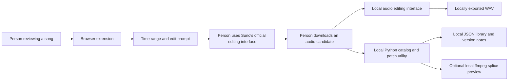

# Architecture and trust boundaries

This is a local workflow for helping a person edit a limited section of an AI generated song. The tools do not access the user's Suno account, credentials, or private API endpoints.

## How the pieces fit together

The arrows represent a suggested human controlled workflow, not automatic connections among all three tools.

## Components

| Component | Purpose | Storage or execution | Current validation |
| --- | --- | --- | --- |
| Browser extension | Mark a song range and prepare an edit prompt | Browser local storage and content scripts on suno.com | Automated prompt builder tests, valid extension manifest |
| Offline editing page | Preview and export an audio splice using files provided by the user | Local browser processing | Basic sample WAV smoke tests documented; real user audio coverage not verified |
| Python CLI | Track songs, issues, attempts, versions, and optional local audio splice previews | Python standard library, local JSON files, optional locally installed ffmpeg | Unit tests run on multiple Python versions through CI |

## Boundaries that should not change

1. No Suno credentials, private account session cookies, private endpoints, or unauthorized site automation.
2. No upload of audio files to a project operated server. Files selected for local editing stay under the user's control.
3. No automatic publishing or modifying a Suno account.
4. Preserve original song versions instead of silently overwriting them.
5. No claimed time savings, audio fidelity gains, or real world adoption metrics without measurement.

## What is intentionally not provided

This project is not an audio generation model, a Suno API integration, or a commercial editing service. The three parts are individual tools that support the same manual workflow, not a tightly coupled production platform.

Browser compatibility, audio edge cases, security, accessibility, and use with a larger selection of real tracks still need verification.

## Engineering artifacts

[Automated tests](../.github/workflows/tests.yml)

[Python tests](../cli/tests)

[Browser extension logic tests](../extension/tests)

[Security policy](../SECURITY.md)

[Project case study](../PORTFOLIO_CASE_STUDY.md)
